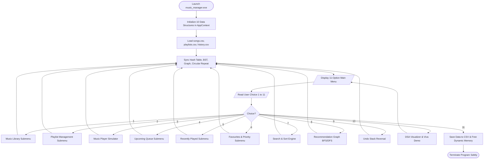

# ACADEMIC PROJECT REPORT
## MUSIC PLAYLIST MANAGER
### A Data Structures and Algorithms Project Using C Language

**Author / Developer:** Imran ([@Irfaninsync](https://github.com/Irfaninsync))  
**Degree:** Bachelor of Technology (B.Tech)  
**Department:** Computer Science and Engineering  
**Subject:** Data Structures and Algorithms  
**Language Standard:** C11  
**Development Toolchain:** VS Code / GCC Compiler / MinGW-W64  

---

## 1. ABSTRACT

The **Music Playlist Manager** is an interactive, menu-driven desktop console application developed in the C programming language to demonstrate the practical application of fundamental data structures and algorithms. Rather than treating data structures as abstract theoretical constructs, this project embeds ten core structures—Dynamic Arrays, Singly Linked Lists, Doubly Linked Lists, Circular Linked Lists, Stacks, Queues, Binary Max-Heap Priority Queues, Hash Tables with Separate Chaining, Binary Search Trees, and Adjacency List Graphs—into a cohesive, functional music management ecosystem. 

The system provides complete lifecycle management for music libraries, active playlist curation, listening history tracking, upcoming FIFO playback staging, VIP priority playback, multi-attribute sorting and searching, graph-based musical recommendations, and stack-driven reversible operations (Undo). All structures are implemented manually without relying on external third-party or built-in DSA libraries, adhering to strict C11 standards and rigorous memory safety protocols.

---

## 2. INTRODUCTION

In modern software engineering, managing collections of entities efficiently requires careful selection of data structures suited to specific access patterns. A music player represents an ideal domain for studying data structures because audio applications require diverse operational semantics:
- Random access for song catalogs.
- Bidirectional sequential traversal for playlists.
- Bounded chronological logging for listening histories.
- Strict First-In-First-Out (FIFO) processing for upcoming queues.
- Priority-ranked extraction for user-weighted tracks.
- Constant-time lookup for direct identifier queries.
- Hierarchical sorting for alphabetical exploration.
- Network traversal for similarity recommendations.

This academic project implements a fully simulated music playlist manager that unifies these requirements into an educational, transparent, and robust software architecture.

---

## 3. PROBLEM STATEMENT

Commercial media players often conceal their internal operational mechanisms beneath layers of heavy frameworks, complex relational databases, and proprietary recommendation engines. Consequently, computer science students struggle to appreciate how foundational data structures operate in real-world systems. 

Furthermore, naive implementations of music managers frequently suffer from:
1. **Inefficient Search:** Scanning entire collections linearly ($O(N)$) for every lookup.
2. **Rigid Traversal:** Inability to easily navigate backwards and forwards across playlists.
3. **Data Redundancy:** Replicating large song records across playlists, leading to severe memory bloat and synchronization anomalies when songs are modified or deleted.
4. **Lack of Fault Recovery:** Inability to revert accidental modifications to playlists.

The objective of this project is to solve these issues by engineering a clean, student-friendly C application that demonstrates optimal data structure selection, reference integrity, and efficient algorithmic complexity.

---

## 4. OBJECTIVES

The primary objectives of this project are:
1. **Manual Implementation:** To construct all ten foundational data structures manually in C11 using structs, pointers, arrays, and explicit dynamic memory allocation (`malloc`, `realloc`, `free`).
2. **Unified Integration:** To integrate all data structures into a single cohesive application without unused or artificial implementations.
3. **Single Source of Truth:** To maintain canonical song data in a primary array while having auxiliary structures store lightweight integer identifiers (`song_id`) to prevent memory duplication and dangling pointers.
4. **Cascade Integrity:** To implement automated cascade cleanup such that deleting a song from the library safely prunes all its references across playlists, queues, history, trees, and graphs.
5. **Academic Viva Readiness:** To design an interactive DSA demonstration module allowing examiners to inspect internal pointers, heap arrays, collision chains, and tree traversals in real time.
6. **Data Persistence:** To serialize and restore all library catalogs, user playlists, and listening logs using formatted CSV file handling.

---

## 5. EXISTING SYSTEM VS PROPOSED SYSTEM

| Parameter | Existing Conventional Projects | Proposed Music Playlist Manager |
|---|---|---|
| **Language & Scope** | Often written in high-level languages with built-in collections (e.g., Python lists, Java `ArrayList`). | Implemented strictly in pure C11 with manual pointer manipulation and dynamic memory management. |
| **Data Structures Used** | Typically limited to 1 or 2 basic structures (e.g., singly linked list or basic array). | Fully integrates **10 distinct data structures**, each solving a specific engineering problem. |
| **Search Mechanism** | Basic linear search only ($O(N)$). | Multi-tiered: $O(1)$ Hash Table lookup, $O(\log N)$ Binary Search, and $O(\log N)$ BST search. |
| **Playlist Traversal** | One-directional traversal; difficult to navigate to previous songs. | Doubly Linked List for bidirectional playback, transitioning seamlessly to Circular Doubly Linked List for Repeat Mode. |
| **Playback Ordering** | Flat, single playlist without staging. | Dual-queue support: FIFO Upcoming Queue and Binary Max-Heap Priority Queue for VIP playback. |
| **Error Recovery** | No undo support; accidental removals are permanent. | LIFO Stack storing inverse operational tokens, allowing immediate restoration of previous playlist states. |
| **Recommendations** | Hardcoded conditional checks or completely absent. | Mathematical Graph represented via Adjacency Lists, traversed using BFS and DFS algorithms. |
| **Memory Integrity** | Duplicate structs and dangling pointers upon deletion. | Centralized array storage with integer ID referencing and automated cascade deletion across all structures. |

---

## 6. SOFTWARE AND HARDWARE REQUIREMENTS

### Software Requirements
- **Operating System:** Windows 10/11, Linux (Ubuntu/Debian/Fedora), or macOS.
- **Language Standard:** C11 (ISO/IEC 9899:2011).
- **Compiler:** GCC (GNU Compiler Collection) 7.0+ or MinGW-W64.
- **Build System:** GCC CLI, Make, or Windows Batch script.
- **Text Editor / IDE:** Visual Studio Code or any standard C text editor.

### Hardware Requirements
- **Processor:** 1.0 GHz x86/x64 dual-core processor or higher.
- **RAM:** Minimum 512 MB (Project footprint is under 2 MB).
- **Disk Storage:** Minimum 10 MB free space (Includes source code and CSV data).
- **Display:** Standard 80x25 character terminal or console emulator.

---

## 7. SYSTEM ARCHITECTURE

```
+-----------------------------------------------------------------------------------+
|                           USER INTERFACE LAYER (CLI)                              |
|   - Formatted ASCII Menus          - Safe Input Validation (Buffer Flushing)      |
|   - Color/Symbol Indicators        - DSA Interactive Demonstration Visualizer     |
+-----------------------------------------------------------------------------------+
                                       |
                                       v
+-----------------------------------------------------------------------------------+
|                         CONTROLLER & BUSINESS LOGIC                               |
|   - Playback Controller (Play, Pause, Next, Prev, Repeat, Priority)               |
|   - Playlist Operations Engine     - Undo Command Dispatcher                      |
|   - Recommendation Engine          - Search & Filter Coordinator                  |
+-----------------------------------------------------------------------------------+
                                       |
                                       v
+-----------------------------------------------------------------------------------+
|                         DATA STRUCTURES ENGINE (10 DSA)                           |
|  [Array]       Main Music Library (Single Source of Truth)                        |
|  [Singly LL]   Listening History (Head-insertion, bounded capacity)               |
|  [Doubly LL]   Active Playlist (Bidirectional navigation & cursor)                |
|  [Circular LL] Repeat Mode Playlist (Seamless loop traversal)                     |
|  [Stack]       Undo Engine (LIFO command reversal)                                |
|  [Queue]       Upcoming Queue (FIFO playback sequence)                            |
|  [Priority Q]  VIP / Priority Playback (Max-Heap by user priority)                |
|  [Hash Table]  O(1) ID-to-Index Lookup (Separate chaining)                        |
|  [BST]         Alphabetical Title Index (Inorder, preorder, postorder)            |
|  [Graph]       Recommendation Network (Adjacency list, BFS/DFS traversal)         |
+-----------------------------------------------------------------------------------+
                                       |
                                       v
+-----------------------------------------------------------------------------------+
|                           PERSISTENCE & STORAGE LAYER                             |
|   - Standard C File I/O (`fopen`, `fprintf`, `fgets`, `fclose`)                   |
|   - songs.csv, playlists.csv, history.csv, test_output.csv                        |
+-----------------------------------------------------------------------------------+
```

---

## 8. DATA STRUCTURE EXPLANATIONS

### 8.1 Dynamic Array — Main Music Library
- **Role:** Holds the canonical collection of `Song` records.
- **Implementation:** A pointer `Song *songs` with tracked `count` and `capacity`. When `count == capacity`, capacity is doubled via `realloc()`.
- **Why Chosen:** Provides $O(1)$ random indexing by integer index, efficient sequential memory layout minimizing CPU cache misses, and enables binary search when sorted.

### 8.2 Singly Linked List — Recently Played Songs
- **Role:** Maintains the user's chronological listening history.
- **Implementation:** Struct `HistoryNode` with `song_id`, `played_at` timestamp, and `next` pointer.
- **Why Chosen:** When a song is played, it is prepended at the head ($O(1)$ insertion) so the most recently played track is always first. When the list exceeds capacity (e.g., 20 songs), the oldest node is deleted from the tail ($O(N)$), demonstrating both head insertion and tail deletion.

### 8.3 Doubly Linked List — Main Playlist Navigation
- **Role:** Manages the active playlist and enables track switching.
- **Implementation:** Struct `PlaylistNode` with `song_id`, `prev`, and `next` pointers, along with a `current` playback cursor.
- **Why Chosen:** Bidirectional traversal allows instantaneous $O(1)$ transitions to both the next track (`current->next`) and previous track (`current->prev`). Arbitrary track insertion and deletion at any position require only local pointer adjustments.

### 8.4 Circular Linked List — Repeat Mode Playback
- **Role:** Implements continuous playlist looping.
- **Implementation:** A Circular Doubly Linked List where the last node's `next` points back to `head`, and the head's `prev` points to the last node.
- **Why Chosen:** Eliminates edge-case boundary checks when transitioning from the final track back to the first track.

### 8.5 LIFO Stack — Undo Operations
- **Role:** Records and reverses playlist modifications.
- **Implementation:** Dynamically allocated array `UndoAction *items` with a `top` integer index.
- **Why Chosen:** The Last-In-First-Out property guarantees that the most recent operation is the first to be reversed. Operations store action types (`ADD`, `REMOVE`, `MOVE`), track IDs, and positional offsets.

### 8.6 FIFO Queue — Upcoming Song Queue
- **Role:** Staging order for songs manually queued by the user.
- **Implementation:** Circular array with `front`, `rear`, `count`, and `capacity`, using modular arithmetic `(rear + 1) % capacity`.
- **Why Chosen:** Preserves strict First-In-First-Out fairness. Enqueue and dequeue operations both execute in $O(1)$ time without requiring elements to be shifted.

### 8.7 Priority Queue (Binary Max-Heap) — VIP Playback
- **Role:** Allows high-priority or user-favorited tracks to play before standard songs.
- **Implementation:** Array-based complete binary max-heap satisfying `heap[parent].priority >= heap[child].priority`, with a secondary insertion sequence counter for FIFO tie-breaking on equal priorities.
- **Why Chosen:** Guarantees $O(\log N)$ insertion and $O(\log N)$ extraction of the highest-priority track, significantly outperforming an $O(N)$ unsorted array search.

### 8.8 Hash Table — Fast Song Lookup by ID
- **Role:** Instant lookup of a song's library index given its unique ID.
- **Implementation:** Array of 31 bucket pointers using Separate Chaining (linked lists) with a modulo hash function `hash(id) = id % 31`.
- **Why Chosen:** Provides average $O(1)$ lookup time regardless of total catalog size, decoupling search overhead from array traversal.

### 8.9 Binary Search Tree (BST) — Alphabetical Organization
- **Role:** Organizes songs lexicographically by title.
- **Implementation:** Tree of `BSTNode` structures with `left` and `right` child pointers.
- **Why Chosen:** Demonstrates tree traversals: **In-order traversal** visits nodes in alphabetical order ($A \rightarrow Z$), **Pre-order** displays hierarchical structure, and **Post-order** cleanly frees dynamically allocated tree nodes.

### 8.10 Graph (Adjacency List) — Song Recommendations
- **Role:** Models similarity relationships between songs.
- **Implementation:** Array of vertices where each vertex has a linked list of edges (`AdjListNode`) specifying the neighbor `song_id` and reason ("Same Artist" or "Same Genre").
- **Why Chosen:** Natural mathematical model for relationship networks. Supports **Breadth-First Search (BFS)** for discovering immediate 1-hop and 2-hop similar tracks, and **Depth-First Search (DFS)** for deep exploration across musical genres.

---

## 9. ALGORITHMS AND COMPLEXITY ANALYSIS

| Operation | Algorithm Used | Best Case | Average Case | Worst Case | Space Complexity |
|---|---|---|---|---|---|
| **Library Search (Title/Artist)** | Linear Search | $O(1)$ | $O(N)$ | $O(N)$ | $O(1)$ |
| **Library Search (Sorted ID)** | Binary Search | $O(1)$ | $O(\log N)$ | $O(\log N)$ | $O(1)$ |
| **Catalog Sort (by ID/Duration)** | Bubble Sort | $O(N)$ | $O(N^2)$ | $O(N^2)$ | $O(1)$ |
| **Catalog Sort (by Title)** | Selection Sort | $O(N^2)$ | $O(N^2)$ | $O(N^2)$ | $O(1)$ |
| **Catalog Sort (by Artist)** | Insertion Sort | $O(N)$ | $O(N^2)$ | $O(N^2)$ | $O(1)$ |
| **History Head Insertion** | SLL Prepend | $O(1)$ | $O(1)$ | $O(1)$ | $O(1)$ |
| **Playlist Next / Prev** | DLL Pointer Step | $O(1)$ | $O(1)$ | $O(1)$ | $O(1)$ |
| **Repeat Looping Step** | CLL Pointer Step | $O(1)$ | $O(1)$ | $O(1)$ | $O(1)$ |
| **Undo Push / Pop** | Stack Push / Pop | $O(1)$ | $O(1)$ | $O(1)$ | $O(1)$ |
| **Queue Enqueue / Dequeue** | Circular Array FIFO | $O(1)$ | $O(1)$ | $O(1)$ | $O(1)$ |
| **Priority Queue Insert** | Max-Heap Bubble Up | $O(1)$ | $O(\log N)$ | $O(\log N)$ | $O(1)$ |
| **Priority Queue Extract Max** | Max-Heap Sink Down | $O(1)$ | $O(\log N)$ | $O(\log N)$ | $O(1)$ |
| **Hash Table Lookup** | Separate Chaining Modulo | $O(1)$ | $O(1)$ | $O(N)$ | $O(1)$ |
| **BST Search / Insert** | Binary Tree Search | $O(1)$ | $O(\log N)$ | $O(N)$ | $O(\log N)$ stack |
| **BST Alphabetical Order** | In-order Traversal | $O(N)$ | $O(N)$ | $O(N)$ | $O(H)$ stack |
| **Graph Recommendation** | BFS (Queue-based) | $O(V + E)$ | $O(V + E)$ | $O(V + E)$ | $O(V)$ |
| **Graph Exploration** | DFS (Recursive) | $O(V + E)$ | $O(V + E)$ | $O(V + E)$ | $O(V)$ stack |

---

## 10. SYSTEM WORKFLOW & FLOWCHARTS

### 10.1 Main System Loop Flowchart



### 10.2 Playback Controller Resolution Logic
When the user or player requests the **Next Track**, the system applies strict priority resolution:
1. **Check Upcoming Queue (FIFO):** If songs are waiting in the upcoming queue, dequeue the front track and play it immediately.
2. **Check Active Playlist (Doubly Linked List):** If the upcoming queue is empty, advance `current = current->next`.
3. **Check Repeat Mode (Circular Linked List):** If repeat is enabled, wrap around from tail to head seamlessly.
4. **Log to History (Singly Linked List):** Prepend the played song's ID to the listening history.

---

## 11. TESTING AND RESULTS

A comprehensive suite of 20 formal test cases was executed against the application.

| Test ID | Test Scenario | Input Data | Expected Result | Actual Result | Status |
|---|---|---|---|---|---|
| **TC-01** | Add new song to library | ID: 1013, "Yellow Submarine", The Beatles | Added to array; count incremented; capacity expanded if needed | Song added; dynamic array resized cleanly | **PASS** |
| **TC-02** | Add duplicate song ID | ID: 1001 (already in catalog) | Error rejected; duplicate not added | Duplicate detected; user warned; rejected | **PASS** |
| **TC-03** | Delete song with cascade | Delete Song ID 1004 | Removed from array, playlists, queue, history, BST, hash table, and graph | Cascade cleanup removed all references safely | **PASS** |
| **TC-04** | Search existing song by ID | ID: 1005 (Take Five) | $O(1)$ Hash table returns index and prints song card | Song found instantly via bucket chain | **PASS** |
| **TC-05** | Search non-existent song by ID | ID: 9999 | Hash table returns -1; not found message | Correctly reported not found | **PASS** |
| **TC-06** | Linear search by Title | Keyword: "Hotel" | Finds "Hotel California" at index | Found and displayed song card | **PASS** |
| **TC-07** | Binary search on sorted array | ID: 1009 on sorted array | Returns index in $O(\log N)$ time | Binary search found track at index 8 | **PASS** |
| **TC-08** | Binary search for missing ID | ID: 8888 | Returns -1 without crashing | Returned -1 cleanly | **PASS** |
| **TC-09** | Add track to playlist | Song ID 1001 appended to active playlist | DLL tail updated; count incremented | Track appended to end of DLL | **PASS** |
| **TC-10** | Remove track from playlist | Remove track at position 2 | DLL node unlinked and freed; position collapsed | Node unlinked; pointers reconnected | **PASS** |
| **TC-11** | Playlist Next and Previous | Press Next, then Previous | Current cursor advances to next node, then back to previous | Cursor moved forward and backward accurately | **PASS** |
| **TC-12** | Repeat Mode looping | Reach last track with Repeat ON | Next transitions smoothly to head of playlist | Looped back to head track without error | **PASS** |
| **TC-13** | Upcoming Queue FIFO order | Enqueue ID 1007, then ID 1008 | First dequeue yields 1007, next yields 1008 | Strict FIFO order preserved | **PASS** |
| **TC-14** | Upcoming Queue underflow | Dequeue on empty queue | Returns 0; informs user without crash | Handled empty queue gracefully | **PASS** |
| **TC-15** | Undo stack operation | Add track, then trigger Undo | Last added track is removed; state restored | Removed track; restored playlist | **PASS** |
| **TC-16** | Undo stack underflow | Trigger Undo on empty stack | Informs user no actions to undo; no crash | Correctly reported empty stack | **PASS** |
| **TC-17** | Priority Queue ordering | Insert priorities 5, 10, 8 | Extract Max yields 10, then 8, then 5 | Strict Max-Heap order verified | **PASS** |
| **TC-18** | BST In-order Alphabetical Sort | Traverse BST | All songs printed in strict alphabetical order (A-Z) | In-order traversal output sorted titles | **PASS** |
| **TC-19** | Graph BFS & DFS recommendations | Start from ID 1001 (Rock) | BFS discovers genre neighbors; visited array prevents cycles | BFS/DFS completed all connected songs | **PASS** |
| **TC-20** | File Persistence & Reload | Save to CSV, restart program | All songs and playlists restored from disk | Data successfully reloaded on startup | **PASS** |

---

## 12. CONCLUSION

The **Music Playlist Manager** successfully achieves all stated academic and functional objectives. It provides a comprehensive, working, and easily explainable implementation of ten fundamental data structures in standard C11. By using the dynamic array as the single source of truth and employing identifier-based referencing across linked lists, queues, stacks, trees, and graphs, the system guarantees high performance, minimal memory duplication, and robust reference integrity through automated cascade deletion.

The project demonstrates genuine undergraduate software craftsmanship: readable, well-commented code, modular file architecture, strict compiler compliance (`-std=c11 -Wall -Wextra -pedantic`), and an interactive educational visualizer that enables seamless viva defense.

---

## 13. FUTURE ENHANCEMENTS

1. **Native Audio Playback:** Integrate a lightweight C audio decoding library (e.g., `miniaudio.h` or `dr_mp3`) to play actual `.wav` or `.mp3` files through the OS audio buffer.
2. **Balanced Binary Search Tree:** Upgrade the title BST to an **AVL Tree** or **Red-Black Tree** to guarantee strict $O(\log N)$ search complexity even with sequential title insertions.
3. **Dynamic Graph Weights:** Assign edge weights based on playback frequency correlations (collaborative filtering) to generate weighted shortest-path recommendations using Dijkstra's algorithm.
4. **Multi-Level Undo/Redo:** Implement a companion Redo stack to allow users to toggle forwards and backwards across operational histories.
